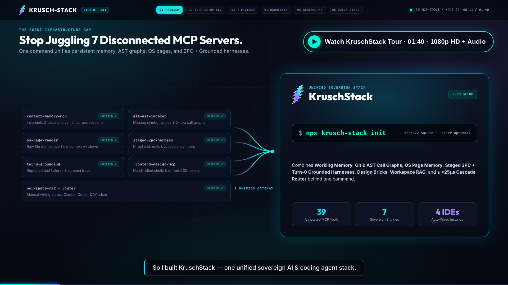

# KruschStack (`krusch-stack`)

[](LICENSE)
[](https://nodejs.org)
[](https://modelcontextprotocol.io)
[-00e5ff.svg)](https://krusch.dev/articles/return-on-memory-dolphinbench)
[-brightgreen.svg)](https://huggingface.co/krush420/gemma4-31b-sre-lora)

`krusch-stack` (`v1.3.0`) is a local, zero-cloud control plane for AI coding agents (Claude Code, Cursor, Windsurf, Antigravity, Codex). It gives your agent persistent cross-session memory, Turn-0 workspace grounding, spin-loop protection, and two-phase commit (2PC) file safety backed by Node 22 native `node:sqlite`.

---

## ⚡ 30-Second Value Demo & Progressive Quickstart (Zero API Keys, Zero Docker)

Run the offline 3-act walkthrough in `<1s` inside an isolated temporary SQLite workspace before touching any project files:

```bash
npx krusch-stack demo
```

```text
KruschStack v1.3.0 -- 3-Act Zero-Cloud Control Plane Walkthrough (<1s, node:sqlite WAL)
  [Act 1] Cross-Session Memory
          Session 1 saved invariant #1 ("Never use eval() in payment modules" @ src/pay.js)
          Session 2 cold-restarted -> hydrated invariant #1 (SHA-256 drift_status: VALID)
  [Act 2] Unsafe Edit, Spin-Loop & Output Defect Refusal
          1. Proposed eval(payload) edit     -> BLOCKED_INVARIANT (0 bytes written to disk)
          2. Repeated failing tool call      -> BLOCK_SPIN_LOOP (0 duplicate executions)
          3. Emitted raw np.float64(0.015)   -> REJECT_OUTPUT_DEFECT (caught before user reply)
  [Act 3] Verified 2PC Atomic Apply
          Staged unified diff -> write-ahead journal -> POSIX atomic rename -> APPLIED (src/pay.js)
Result: PASS (3/3 acts verified offline in 48ms)
```

### Install Into Your Workspace

```bash
# 1. Configure Claude Code, Cursor, Windsurf & Antigravity (defaults to lean 19-tool coding-agent profile)
npx krusch-stack init

# 2. Verify Node >= 22, SQLite WAL health, and all 21 control-plane tables
npx krusch-stack doctor

# 3. Inspect any recent block, memoized read, or 2PC commit ("Why did the agent block that?")
npx krusch-stack explain
```

Prefer letting your coding agent set it up for you? Paste this prompt into Claude Code, Codex, Cursor, Windsurf, or Antigravity:

```text
Read https://raw.githubusercontent.com/kruschdev/krusch-stack/main/INSTALL.md and set up krusch-stack on this machine.
```

### Opinionated Profiles (Pick Only What You Need)

| Profile Flag | Tools Exposed | Approx. Schema Budget | Best For & Included Capabilities |
| :--- | :--- | :--- | :--- |
| `--profile memory-only` | **5 tools** | `~350` tokens | **Persistent Memory Only**: Decisions, invariants, pre-commit `nudge`, and SHA-256 line-span drift checks (`krusch-context-mcp`). |
| `--profile coding-agent` | **19 tools** *(Default for `init`)* | `~1,450` tokens | **Daily Coding Agents**: Persistent memory + AST symbol/call-graph search (`krusch-git`) + 2PC staged file harness (`+ krusch-grounded-harness` in `--modular` mode). |
| `--profile core` | **27 tools** | `~2,100` tokens | **Backend & Systems Engineering**: Adds bounded OS PageMemory (`krusch-fs`) and `<25µs` L1-L3 Cascade Router. |
| `--profile full` | **39 tools** *(Default for `mcp`/`serve`)* | `~3,100` tokens (`~600` w/ `--defer-tools`) | **Full Ecosystem**: Adds Frontend Design templates and Workspace Docs RAG (`--include-extended` or `--modular` adds the 23 extension tools; `--defer-tools` compresses any profile by `-80.67%` schema tokens via BM25 deferral). |

Need custom composition or Docker? Use `npx krusch-stack mcp --components context,git,harness`, `npx krusch-stack init --modular` (dedicated per-pillar MCP entries), or `docker compose up -d` (`http://127.0.0.1:3780/health` + companion PostgreSQL 16 `db/init.sql`).

> 📘 **Focused 3-Minute Guides & Community**:
> - **[Adding Reliable Memory to Cursor and Claude Code in One Command](docs/guides/adding-memory-to-cursor-and-claude-code.md)** (`--profile memory-only`, 5 verbs, SHA-256 span drift vs. stale `CLAUDE.md`)
> - **[Why Two-Phase Commit (2PC) for Agent File Writes](docs/guides/why-2pc-for-agent-file-writes.md)** (staging unified diffs, pre-commit invariants, and `<32ms` `SIGKILL`-safe journal recovery)
> - **[GitHub Discussions](https://github.com/kruschdev/krusch-stack/discussions)** (questions, local GPU setups, and benchmark reproductions)

### 🎬 Optional Watch: 100-Second Narrated Product Tour (`1080p`)

[](https://krusch.dev/assets/video/krusch-stack-tour.mp4)

> ▶️ **[Stream 1080p HD Product Tour (`01:40`, with audio)](https://krusch.dev/assets/video/krusch-stack-tour.mp4)** | **[Interactive Player on `krusch.dev`](https://krusch.dev/#video-krusch-stack)** | **[Local MP4](docs/video/krusch-stack-tour.mp4)** | **[WebM](docs/video/krusch-stack-tour.webm)** | **[Closed Captions (`.srt`)](docs/video/krusch-stack-tour.srt)**

---

## 🩹 Before vs. After: Three Agent Failure Modes Fixed

### 1. Agent Amnesia & Stale Rules
- **Before (`CLAUDE.md` / Stateless Chat)**: Your agent forgets last week's architectural constraint in a new session, or blindly follows an outdated rule in `CLAUDE.md` long after the underlying function moved or was refactored.
- **After (`krusch-context-mcp`)**: `krusch_context_retrieve` hydrates token-budgeted decisions and invariants at Turn 1, verifies anchored code spans via SHA-256 (`VALID`, `HEALED_LINE_SHIFT`, or `STALE_DRIFT`), and tracks explicit supersession lineage via `krusch_context_revise`.

### 2. Unsafe Direct File Writes & Torn Multi-File Edits
- **Before (Unchecked `write_file`)**: Your agent overwrites 4 files directly on disk, introduces a banned pattern or breaks imports, and leaves a half-written repository if the process crashes or hits a timeout mid-edit.
- **After (`krusch-harness` 2PC)**: `krusch_run` audits proposed edits against active invariants (`krusch_context_nudge`) before touching disk and stages a unified diff in SQLite. `krusch_apply_diff` commits changes through a `<32ms` write-ahead journal (`harness_apply_journal`) and POSIX atomic rename with automatic `SIGKILL` startup rollback.

### 3. Tool Spam, Spin Loops & CSV `"NA"` Traps
- **Before (Raw Tool Loop)**: A local or cloud model burns 15 turns re-reading the same file with identical arguments, misparses literal `"NA"` (North America) in a CSV as `NaN`, or leaks `np.float64(0.015)` / unresolved placeholders into its final answer.
- **After (`grounded-harness`)**: Injects zero-LLM Turn-0 workspace schema hazards (`keep_default_na=False`, JSON `null`/`[]` wildcards, SQLite DDL), memoizes repeat reads (`MEMOIZED_PRIOR_READ`), blocks spin loops in `0` re-executions (`BLOCK_SPIN_LOOP`), and gates objective output defects (`REJECT_OUTPUT_DEFECT`) while costing `0` extra turns when clean.

---

## 🧩 Adopt One Piece Without the Rest (Zero Ecosystem Lock-In)

You do not have to buy into all 10 pillars to use `krusch-stack`. Every subsystem ships as an independent MIT repository and as an isolated ESM subpath export:

| Capability Needed | Standalone Repository | Single-Piece CLI or ESM Import via `krusch-stack` |
| :--- | :--- | :--- |
| **Persistent Memory Only (`5` MCP verbs)** | [`kruschdev/krusch-context-mcp`](https://github.com/kruschdev/krusch-context-mcp) | `npx krusch-stack mcp --profile memory-only` |
| **Turn-0 Grounding & Spin-Loop Gate** | [`kruschdev/grounded-harness`](https://github.com/kruschdev/grounded-harness) | `import { createGroundedHarnessEngine } from 'krusch-stack/grounded-harness'` |
| **2PC File & Tool-Action Harness** | [`kruschdev/krusch-coding-harness`](https://github.com/kruschdev/krusch-coding-harness) | `import { createActionHarnessEngine } from 'krusch-stack/action-harness'` |
| **Reusable Runtime Bricks (Node/TS & Python)** | [`kruschdev/toolkit`](https://github.com/kruschdev/toolkit) | `@krusch/toolkit` (`40` JS/TS bricks) & `krusch_toolkit` (Python `3.11+`) |

---

## 🏗️ Architecture: Deterministic Control Plane vs. Interchangeable LLM

`krusch-stack` keeps state, safety invariants, schema hazards, and atomic file commits inside a deterministic local database (`node:sqlite` WAL by default, with 21-table PostgreSQL 16 + `pgvector` DDL parity in `db/init.sql`), so you can swap local open-weights models and frontier cloud APIs without losing memory or safety guarantees:

```text
  IDE / Agent Host (Claude Code, Cursor, Windsurf, Antigravity, Codex, HTTP Client)
                                         │
                                         ▼
┌───────────────────────────────────────────────────────────────────────────────────┐
│        DETERMINISTIC LOCAL CONTROL PLANE (SQLite WAL / PostgreSQL 16 DDL)         │
│                                                                                   │
│  ┌─────────────────────────┐  ┌─────────────────────────┐  ┌───────────────────┐  │
│  │ 1. Working Memory       │  │ 2. AST & Graph Context  │  │ 3. Grounded Gate  │  │
│  │ • Invariants & lineage  │  │ • Symbol & call graphs  │  │ • Turn-0 schemas  │  │
│  │ • SHA-256 span drift    │  │ • Bounded OS PageMemory │  │ • Spin-loop block │  │
│  │ • git blame co-change   │  │ • Temporal ADR graph    │  │ • Defect-only gate│  │
│  └─────────────────────────┘  └─────────────────────────┘  └───────────────────┘  │
│  ┌─────────────────────────────────────────┐  ┌────────────────────────────────┐  │
│  │ 4. Two-Phase Commit (2PC) Harness       │  │ 5. Observability & Routing     │  │
│  │ • Pre-disk invariant nudge              │  │ • `explain` & `GET /telemetry` │  │
│  │ • <32ms write-ahead journal + rename    │  │ • <25µs L1-L3 Cascade Router   │  │
│  └─────────────────────────────────────────┘  └────────────────────────────────┘  │
└────────────────────────────────────────┬──────────────────────────────────────────┘
                                         │  Bounded prompts + verified tool calls
                                         ▼
┌───────────────────────────────────────────────────────────────────────────────────┐
│                         INTERCHANGEABLE LLM WORKER                                │
│    Local 12-48 GB Ollama (`$0.00`: Gemma 4 31B, Qwen3-Coder 30B MoE, 7B/8B)       │
│    or Frontier Cloud API (Gemini 4 Argon, Claude, GPT, DeepSeek, OpenRouter)      │
└───────────────────────────────────────────────────────────────────────────────────┘
```

### Complete 10-Pillar Reference Table

| Capability (Internal Module Name) | Standalone Repo | Key Tools & Subpath Surfaces | Default Storage |
| :--- | :--- | :--- | :--- |
| **Persistent Working Memory & Git Alignment (`krusch-context-mcp`)** | [`krusch-context-mcp`](https://github.com/kruschdev/krusch-context-mcp) | `krusch_context_retrieve`, `remember`, `revise`, `nudge` (`git blame -w -M` + co-change), `health` (`krusch-stack/git-alignment`) | `node:sqlite` (`db/init.sql` PG parity) |
| **Codebase AST & Call-Graph Search (`krusch-git`)** | [`krusch-git`](https://github.com/kruschdev/krusch-git) | `krusch_git_search_symbols`, `file_symbols`, `dependency_graph`, `semantic_search` (2-hop `git_edges` bridge), `read_tree`, `read_blob`, `list_repos` | `node:sqlite` (`db/init.sql` PG parity) |
| **Bounded OS Page Memory (`krusch-fs`)** | [`krusch-fs-mcp`](https://github.com/kruschdev/krusch-fs-mcp) | `krusch_fs_locate`, `search`, `page_tree`, `read_page`, `remember_on_page`, `sync` (`.env` `KEYS_ONLY` redaction + secret shield) | `node:sqlite` (`db/init.sql` PG parity) |
| **Temporal Graph Context (`hydrascope`)** | [`HydraScope`](https://github.com/kruschdev/HydraScope) | `krusch-stack/hydrascope`, `POST /hydrascope/*`, & `--server hydrascope` (`traverse_context` w/ `asOf` `:SUPERSEDES`, `check_answerable`, `compare_vector_vs_graph`) | `node:sqlite` (`db/init.sql` PG parity) |
| **Signed Module Reuse & 2-Hop Blast Radius (`brick-exchange`)** | [`toolkit`](https://github.com/kruschdev/toolkit) / [`HydraScope`](https://github.com/kruschdev/HydraScope) | `krusch-stack/brick-exchange`, `POST /brick-exchange/*`, & `--server krusch-brick-exchange` (Ed25519 `--permission` seals, 2-hop AST fan-out, `$0` hexagonal binding) | `node:sqlite` (`db/init.sql` PG parity) |
| **2PC Staged File & Action Harness (`krusch-harness`)** | [`krusch-coding-harness`](https://github.com/kruschdev/krusch-coding-harness) | `krusch_run`, `task_status`, `diff`, `apply_diff`, `explain`, `reject`, `abort` + `krusch-stack/action-harness` (`POST /action-harness/*`) | `node:sqlite` (`db/init.sql` PG parity) |
| **Turn-0 Schema Grounding & Spin-Loop Gate (`grounded-harness`)** | [`grounded-harness`](https://github.com/kruschdev/grounded-harness) | `krusch-stack/grounded-harness`, `POST /grounded-harness/*`, & `--server krusch-grounded-harness` (Turn-0 CSV/JSON/SQLite scan, scale profiles, defect-only stop) | `node:sqlite` (`db/init.sql` PG parity) |
| **Frontend Design & Component Templates (`krusch-frontend-mcp`)** | [`krusch-frontend-mcp`](https://github.com/kruschdev/krusch-frontend-mcp) | `get_canonical_template` (`16` HTML/SVG + Lego/Vercel templates), `list_canonical_templates`, `generate_color_palette`, `css_to_tailwind`, `query_design_rules`, `generate_responsive_breakpoints` | `node:sqlite` (`db/init.sql` PG parity) |
| **Workspace & Docs RAG (`g-krusch`)** | [`G-krusch`](https://github.com/kruschdev/G-krusch) | `get_agent_steering`, `search_drive_rag`, `read_drive_file`, `write_drive_file`, `list_drive_workspace`, `get_workspace_status` | `node:sqlite` (`db/init.sql` PG parity) |
| **Task Routing, Prerequisite ToolGraph & Polyglot Audit (`krusch-cascade-router`)** | [`krusch-cascade-router`](https://github.com/kruschdev/krusch-cascade-router) | `krusch_route_task`, `krusch_stack_status`, `krusch-stack/tool-graph` (`<1ms` `CONSUMES -> PRODUCED_BY`), & `krusch-stack/polyglot-audit` (`28` brownfield rules) | In-Memory (`<25µs` to `<1ms` CPU) |

---

## 🖥️ Recommended Local Open-Weights Setups (`$0` API Spend, 12-48 GB VRAM)

Copy-pasteable local configurations tested against `krusch-stack` scale profiles (`SMALL_MODEL` and `MID_MODEL`):

| Hardware Tier | Recommended Local Models & Adapters | Ollama / Runtime Settings | Recommended `krusch-stack` Flags & Verified Local Outcome |
| :--- | :--- | :--- | :--- |
| **12-16 GB VRAM** *(RTX 3060 / 4060 Ti / 4070)* | `gemma4:e4b` + `qwen2.5-coder:7b` (+ `snowflake-arctic-embed2`) | `num_ctx=16384`, `OLLAMA_KV_CACHE_TYPE=q8_0`, `SMALL_MODEL` scale profile | `npx krusch-stack init --profile coding-agent --defer-tools` (`-80.67%` schema tokens so `16K` context stays clean). |
| **24 GB VRAM** *(RTX 3090 / 4090)* | `qwen3-coder-30b-moe` / [`krush420/qwen3-coder-30b-sre-lora`](https://huggingface.co/krush420/qwen3-coder-30b-sre-lora) (`30.5B` total / `3.3B` active MoE) | `Q4_K_M`, `num_ctx=16384`, `OLLAMA_KV_CACHE_TYPE=q8_0` | `--profile coding-agent` + `Grounded Harness` (`43.00%` [`258/600`] DolphinBench @ `$0.00`; `-95.2%` duplicate MCP calls w/ `2PC`). |
| **32-48 GB VRAM** *(RTX 5090 / A6000 / Apple Silicon)* | [`google/gemma-4-31b-it`](https://huggingface.co/google/gemma-4-31b-it) + [`krush420/gemma4-31b-sre-lora`](https://huggingface.co/krush420/gemma4-31b-sre-lora) (`30.7B` dense, Apache-2.0) | `MID_MODEL` Thinking ON + `Grounded Harness` | **`57.33%` (`344/600`) DolphinBench @ `$0.00`** (highest open-weights score in my 28-run evaluation; `54.17%` stock queued `UUID 288671ad`). |

### Where the Control Plane Closes the Gap (and Where Frontier Models Still Lead)

| Benchmark / Workload | Raw Model Baseline | With `krusch-stack` Control Plane | Relative Lift / Cost Savings |
| :--- | :--- | :--- | :--- |
| **Aider Polyglot (`225/225` coding tasks)** | `19.56%` `Pass@1` | **`51.56%` `Pass@2`** *(2PC test-gated retry)* | **`2.64x` accuracy lift** (ties `Claude 3.5 Sonnet` baseline) |
| **BIRD-SQL (`500/500` text-to-SQL)** | `26.00%` EX | **`40.20%` EX** *(schema + execution gate)* | **`1.55x` accuracy lift** (`100%` syntactically valid SQL) |
| **Adyen DABstep (`data analysis episodes`)** | `20.0%` local / `$3.19` frontier | **`40.0%` local (`$0.00`) / `90.0%` frontier (`$0.81`)** | **`2.0x` local lift** & **`-74.5%` frontier API cost** (`2.54x` faster) |
| **UC Berkeley BFCL v3 Live (`2,251` Qs, `64` tools)** | `59.88%` Micro | **`66.28%` Micro & `84.69%` Irrelevance** (`--defer-tools`) | **`-80.67%` schema tokens** & **`+17.46 pp` irrelevance accuracy** |
| **DolphinBench Tool Hygiene (`600` tasks, `30B`)** | `42` duplicate MCP calls | **`2` duplicate MCP calls** (`30B + 2PC`) | **`-95.2%` wasted duplicate tool calls** @ `$0.00` |

> **Honest Frontier Boundary**: Deterministic memory, Turn-0 schema grounding, and 2PC verification multiply open-weights reliability (`40%-57%` at `$0.00`, beating several ungrounded commercial cloud stacks), while frontier reasoning models (`Gemini 4 Argon`, `GPT 5.6 Luna`) still hold the **`75%-91%` ceiling** on deep multi-hop synthesis and long-horizon recovery when paired with the exact same `krusch-stack` control plane.

---

## 📊 External Benchmarks (3-Tier Verification Taxonomy & One-Command Reproduction)

Evaluated across **335,000+ traces and 14 external benchmarks** (`95/95` SHA-256 verification gates). To keep claims auditable, every benchmark result is separated into three explicit verification tiers:

1. **Tier 1 -- Maintainer-Reviewed & Merged Upstream**: [`RouteWorks/RouterArena` PR #169](https://github.com/RouteWorks/RouterArena/pull/169#issuecomment-6779650408) merged into [`main @ 844e93b`](https://github.com/RouteWorks/RouterArena/commit/844e93b547e6278b01994720de39bfc32ffd18bc) (`0.7263` `github-actions[bot]` CI-verified across `8,400/8,400` live receipts at `$0.3802/1K`; leaderboard table row queued for next batch refresh).
2. **Tier 2 -- Uploaded & Queued on Public Leaderboard**: Official `DolphinBench` (`600/600` tasks) archives uploaded to `dolphinbench.ai` (`status: "queued"` awaiting maintainer leaderboard refresh): **`91.17%` (`547/600` @ `$24.54`)** `Gemini 4 Argon Low + SovereignMemoryStore` (`UUID c047b063`) and **`54.17%` (`325/600` @ `$0.00`)** stock `Gemma 4 31B` (`UUID 288671ad`).
3. **Tier 3 -- Self-Run Clean-Room with SHA-256 Audit Logs**: Reproducible harness evaluations published with raw JSON receipts in [`BENCHMARKS.md`](./BENCHMARKS.md) and [`krush420/sovereign-g4-benchmarks`](https://huggingface.co/datasets/krush420/sovereign-g4-benchmarks).

| Stack Pillar | External Benchmark | Headline Result | Verification Tier |
| :--- | :--- | :--- | :--- |
| **Cascade Router** | **RouteWorks RouterArena (`8,400` live receipts)** | **`0.7263` (`74.44%` Acc @ `$0.38/1K`)**, `2.0x-26.4x` cheaper than `Azure-Model-Router` / `GPT-5` / `Martian` | **Tier 1**: Merged upstream ([PR #169](https://github.com/RouteWorks/RouterArena/pull/169)) |
| **Memory + Control Plane** | **Official DolphinBench (`600/600`, `28` runs)** | **`91.17%` Argon Low (`$24.54`)**; **`81.50%` Luna High + Grounded (`$1.35`)**; **`57.33%` Gemma 4 LoRA + Grounded (`$0.00`)** | **Tier 2** (`UUID c047b063`, `288671ad` queued) & **Tier 3** |
| **Working Memory (`context`)** | **Official Snap LoCoMo (`ACL 2024`, `1,540` Qs)** | **`90.26%` accuracy & `95.77%` `dia_id` recall** at **`$0.00` zero-LLM ingestion** (`181.8ms` median retrieval) | **Tier 3**: Self-Run Clean-Room (SHA-256 logs) |
| **Long-Horizon Memory** | **ICLR 2026 BEAM (`100K` to `10M` tokens, `2,000` Qs)** | **`92.58%` (`100K`) & `93.00%` (`10M` IE) recall** (`78.67%` 4-split weighted; zero E2E drop `100K -> 1M`) | **Tier 3**: Self-Run Clean-Room (SHA-256 logs) |
| **Security & Policy Floor** | **ETH SpyLab AgentDojo v1.2.2 (`949` attacks)** | **`0.00%` Targeted ASR (`0/949` attacks succeeded)** vs. `19.28%` raw ASR (`69.07%` benign utility) | **Tier 3**: Self-Run Clean-Room (SHA-256 logs) |
| **Code AST & Call Graph** | **ACL 2025 CoIR (`162K` Qs) & RepoBench-R (`48K` Qs)** | **`56.40%` CoIR 10-task `NDCG@10` (`73.88%` `R@10`)**; **`68.58%` RepoBench-R `Acc@5`** | **Tier 3**: Self-Run Clean-Room (SHA-256 logs) |
| **2PC & Grounded Harnesses** | **Aider Polyglot (`225`), BIRD-SQL (`500`) & DABstep** | **Polyglot `51.56%` (`2.64x`)**; **BIRD-SQL `40.20%` (`1.55x`)**; **DABstep `90.0%` @ `$0.81` (`-74.5%` cost)** | **Tier 3**: Self-Run Clean-Room (SHA-256 logs) |
| **Deferred MCP (`--defer-tools`)** | **UC Berkeley BFCL v3 Live (`2,251` Qs, `64` tools)** | **`66.28%` Micro (`+6.40 pp`) & `84.69%` Irrelevance (`+17.46 pp`)** at **`-80.67%` schema tokens** | **Tier 3**: Self-Run Clean-Room (SHA-256 logs) |

### One-Command Clean-Room Verification (`<5s`, Zero API Keys)

Clone the repository and verify the deterministic control-plane invariants, 2PC `SIGKILL` crash rollback, spin-loop/defect gates, and SHA-256 benchmark receipts locally:

```bash
git clone https://github.com/kruschdev/krusch-stack.git
cd krusch-stack
npm ci
npm run bench:repro
```

Read the full methodology, competitor tables (`Mem0`, `past.dev`, `Honcho`, `NotDiamond`, `Martian`), and whitepapers in **[`BENCHMARKS.md`](./BENCHMARKS.md)**, [**Paper #27: Return on Memory**](https://krusch.dev/articles/return-on-memory-dolphinbench) ([**PDF**](https://krusch.dev/papers/return-on-memory-dolphinbench.pdf)), [**Paper #26: What DolphinBench Taught Me About Local AI**](https://krusch.dev/articles/what-dolphinbench-taught-me-about-local-ai), and [**Paper #30: Ontological Brick Exchange**](https://krusch.dev/articles/ontological-brick-exchange-deadbolt-common-ground-hydrascope).

---

## 🔍 Production Signals, Observability & Failure Recovery

`krusch-stack` is built to fail closed and answer *"Why did the agent do that?"* without external SaaS tracing:

- **Instant Decision Explanations**: Run `npx krusch-stack explain [task_or_session_id] [--limit 10] [--json]` to inspect the exact rule ID, invariant match, spin-loop hash, or unified diff behind any allowed, memoized, held, or blocked agent step.
- **Structured Telemetry Endpoint**: Query `GET /telemetry` on `npx krusch-stack serve` (`127.0.0.1:3780`, guarded by `Host`/`Origin` CSRF checks and constant-time SHA-256 `KRUSCH_STACK_API_TOKEN` Bearer auth) for live counters (`blocked_invariant`, `spin_loops_blocked`, `memoized_reads`, `output_defects_caught`, `stale_drift`, `journals_rolled_back`).
- **2-Process `SIGKILL` Crash Drill**: Run `npx krusch-stack doctor --crash-drill` to verify that `harness_apply_journal` + startup `recoverInFlight()` cleanly roll back interrupted multi-file renames after hard process termination.
- **Fail-Closed SQLite Corruption Quarantine**: `PRAGMA quick_check` detects corrupted B-trees or FTS5 shadow tables and surfaces `epistemic_status: "STORAGE_ERROR"` instead of silently returning empty memories.

See **[`docs/PRODUCTION.md`](docs/PRODUCTION.md)** for Solo `node:sqlite` WAL vs. Multi-User Team PostgreSQL 16 deployment patterns, security perimeters, and failure recovery playbooks.

---

## 🧪 Programmatic Node.js & HTTP Gateway Quick Reference

```javascript
import { createKruschStack } from 'krusch-stack';

const stack = createKruschStack({ ephemeral: true });

// 1. Cross-session working memory & pre-commit invariant steering (Tier 1)
stack.context.remember({ category: 'invariant', content: 'Never use eval() in production modules.' });

// 2. Turn-0 workspace schema grounding, memoization & defect-only stop gate (Tier 3B)
const grounded = stack.groundedHarness.groundAndStartSession({
  session_id: 'gh-001',
  goal: 'Compute North America merchant settlement fee rate',
  model: 'gemini-4-argon'
});
const stopGate = stack.groundedHarness.verifyStop({
  session_id: 'gh-001',
  candidate_answer: '0.015',
  expect_non_empty_answer: true
});

// 3. Staged 2PC file execution & decision observability (Tier 3A + Observability)
const staged = stack.harness.run({
  goal: 'Add greeting helper',
  edits: [{ file_path: 'src/greet.js', content: 'export const greet = (n) => `Hello ${n}`;\n' }]
});
const metrics = stack.observability.getMetrics();
const auditTrail = stack.observability.explainDecisions({ limit: 5 });
```

**HTTP Gateway (`npx krusch-stack serve`, default `http://127.0.0.1:3780`)**: Exposes `GET /health`, `GET /telemetry`, `GET /tools`, `POST /call`, `POST /action-harness/*`, `POST /grounded-harness/*`, `POST /hydrascope/*`, `POST /brick-exchange/*`, `POST /tool-graph/*`, `POST /polyglot-audit/*`, and `POST /resilience/*` while keeping `ALL_STACK_TOOLS.length === 39` strictly stable.

---

## 🤗 Open-Weights Models & Datasets Trained Through `krusch-stack`

| Resource | Hugging Face / GitHub | Role & Base Architecture |
| :--- | :--- | :--- |
| **31B Dense SRE LoRA (`L2`)** | [`krush420/gemma4-31b-sre-lora`](https://huggingface.co/krush420/gemma4-31b-sre-lora) | [`google/gemma-4-31b-it`](https://huggingface.co/google/gemma-4-31b-it) (`30.7B` dense, Apache-2.0; `57.33%` DolphinBench + Grounded @ `$0.00`) |
| **30B MoE Coding LoRA (`L2`)** | [`krush420/qwen3-coder-30b-sre-lora`](https://huggingface.co/krush420/qwen3-coder-30b-sre-lora) | [`Qwen/Qwen3-Coder-30B-A3B-Instruct`](https://huggingface.co/Qwen/Qwen3-Coder-30B-A3B-Instruct) (`3.3B` active MoE; `43.00%` + Grounded @ `$0.00`) |
| **8B Edge Referee LoRA (`L1.5`)** | [`krush420/llama3-hermes3-8b-sre-lora`](https://huggingface.co/krush420/llama3-hermes3-8b-sre-lora) | [`NousResearch/Hermes-3-Llama-3.1-8B`](https://huggingface.co/NousResearch/Hermes-3-Llama-3.1-8B) (BF16 LoRA + DPO; `15.7x` DolphinBench lift) |
| **120B Teacher QLoRA (`L2.5`)** | [`krush420/gpt-oss-120b-sre-lora`](https://huggingface.co/krush420/gpt-oss-120b-sre-lora) | [`openai/gpt-oss-120b`](https://huggingface.co/openai/gpt-oss-120b) (`5.1B` active MXFP4 MoE; `39.50%` DolphinBench @ `$0.00`) |
| **SFT + DPO Dataset (`18,131` rows)** | [`krush420/sovereign-code-audit-sft`](https://huggingface.co/datasets/krush420/sovereign-code-audit-sft) | 7 zero-leak splits of test-gated remediations, AST code audits, and tool-calling DPO pairs |
| **Hermetic Benchmarks (`95/95` Gates)** | [`krush420/sovereign-g4-benchmarks`](https://huggingface.co/datasets/krush420/sovereign-g4-benchmarks) | Raw JSON evaluation logs, SHA-256 manifests, and merged `RouterArena` PR `#169` receipts |
| **Jean SRE Daemon (`jean-sre`)** | [`kruschdev/Jean-SRE-by-kruschdev`](https://github.com/kruschdev/Jean-SRE-by-kruschdev) | Autonomous 24/7 11-phase code auditor and test-gated remediation harness |

---

## 🤝 Contributing & License

Contributions, bug reports, and clean-room benchmark reproductions are welcome! Read **[`CONTRIBUTING.md`](CONTRIBUTING.md)** for local `node --test` workflows, isolated single-engine development (`src/engines/*`), and CI invariants (`INV-STACK-01..15`), and **[`docs/PRODUCTION.md`](docs/PRODUCTION.md)** for production operations.

MIT © kruschdev <kruschdev@users.noreply.github.com>
